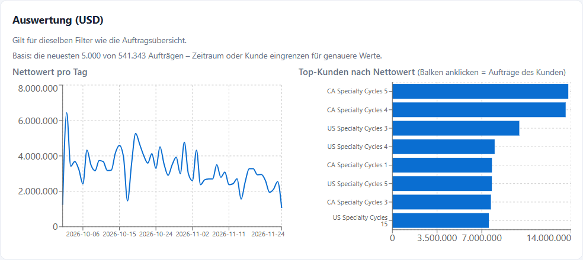
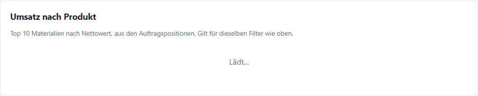
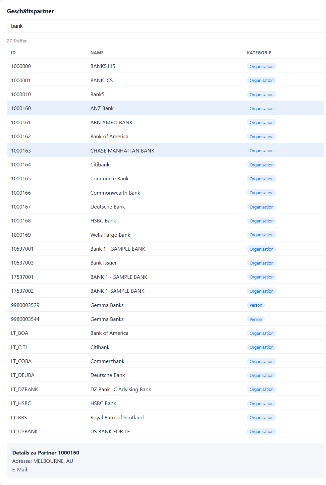

# SAP Business Partners Dashboard

Kleines Portfolio-Projekt: Eine React-Oberfläche zeigt Geschäftspartner und Aufträge aus der **SAP API Business Hub Sandbox** (S/4HANA Cloud, OData v2). Ein FastAPI-Backend kapselt den API-Key und bereitet die Daten auf.


## Funktionen

- **Geschäftspartner-Suche** (`API_BUSINESS_PARTNER`): Es wird erst etwas angezeigt, wenn ein Name oder eine Nummer eingegeben wird (Suche auf dem SAP-Server, max. 50 Treffer, Hinweis „50 von 292 Treffern – bitte Suche verfeinern“)
- **Ladeanzeige** („Lädt...“) und Fehlermeldungen (SAP-Fehler werden mit der Original-Meldung angezeigt)
- **Detailansicht** per Klick auf einen Partner: Adresse und E-Mail-Adresse(n)
- **Auftragsübersicht** (`API_SALES_ORDER_SRV`) mit Paging, Filtern und Positionen
- **Auswertung** mit Recharts (Nettowert pro Tag/Monat, Top-8-Kunden mit Namen)
- **Kennzahlen mit Vorperiodenvergleich**: Nettowert, Anzahl, Ø Auftragswert und Aufträge mit Liefersperre, jeweils im Vergleich zum gleich langen Zeitraum davor
- **Umsatz nach Produkt**: Top 10 Materialien aus den Auftragspositionen (`A_SalesOrderItem`)
- **Währungsfilter**: Aufträge und Auswertungen je Währung (USD, EUR, AUD, ...)
- **CSV-Export** der gefilterten Auftragsliste (Excel-tauglich)
- **Verknüpfte Bereiche**: Partner, Aufträge und Auswertung hängen zusammen (siehe unten)

### Verknüpfung der Bereiche

Aufträge enthalten nur die Kundennummer (`SoldToParty`). Diese ist **identisch mit der Nummer des Geschäftspartners** (`BusinessPartner`). Darüber sind die drei Bereiche verbunden:

| Aktion | Wirkung |
|---|---|
| Partner auswählen → „Aufträge dieses Partners anzeigen“ | Auftragsübersicht und Auswertung werden auf diesen Kunden gefiltert (Filter-Chip mit ✕) |
| Auftrag anklicken | Positionen **und** Kundendaten (Adresse, E-Mail) des Auftrags; Button „Aufträge dieses Partners anzeigen“ |
| Balken im Diagramm anklicken | Auftragsübersicht und Auswertung werden auf diesen Kunden gefiltert |
| Filter ändern (Zeitraum, Status, Währung, Kundenname) | Auftragsübersicht, Auswertung, Produktumsatz **und** CSV-Export nutzen dieselben Filter, also dieselben Aufträge |

Technisch teilen sich die Bereiche einen gemeinsamen Filter-Zustand in `App.tsx`; im Backend bündelt die Klasse `OrderQuery` die Filter für Liste, Auswertung, Produkte und Export.



### Kennzahlen mit Vorperiodenvergleich

- Vier Kennzahlen für den gewählten Zeitraum: **Nettowert**, **Anzahl Aufträge**, **Ø Auftragswert**, **Aufträge mit Liefersperre**
- Verglichen wird mit dem **gleich langen Zeitraum direkt davor** (z. B. 26.10.–24.11. gegen 26.09.–25.10.), mit Veränderung in Prozent (▲/▼; bei Liefersperren ist „mehr“ rot)
- Schnellauswahl: Letzte 7 Tage, Letzte 30 Tage, Dieser Monat, Letzter Monat. Ohne Zeitraum gelten die letzten 30 Tage. Die Auswahl setzt die Datumsfilter und wirkt damit auch auf Liste, Auswertung und Export.
- Alle anderen Filter (Kunde, Status, Währung) gelten für beide Zeiträume; die Währung wird festgelegt, weil Beträge verschiedener Währungen nicht addierbar sind
- Enthält ein Zeitraum mehr als 5.000 Aufträge, beruhen Nettowert und Durchschnitt nur auf den neuesten 5.000 (Hinweis in der Oberfläche, kein Vergleich). Die Anzahlen sind immer exakt (`$inlinecount`).

### Umsatz nach Produkt, Währung und Export



- **Umsatz nach Produkt**: Die Positionen (`A_SalesOrderItem`) der passenden Aufträge werden nach Material zusammengefasst (Positionen, Menge, Nettowert, Anteil). Die Filter des Auftragskopfs (Kunde, Zeitraum, Status) wirken über die Navigation `to_SalesOrder/...` direkt auf dem SAP-Server. Mengen werden nur angezeigt, wenn alle Positionen dieselbe Einheit haben.
- **Währung**: Summen verschiedener Währungen sind nicht addierbar, und die Sandbox liefert keine Wechselkurse. Deshalb gibt es **keine Umrechnung**, sondern einen Währungsfilter (mit Anzahl je Währung). Bei „Alle“ nutzen Auswertung und Produkte die Währung des ersten Treffers und weisen auf übersprungene Datensätze hin.
- **CSV-Export**: Die aktuelle Auswahl (bis zu 5.000 Aufträge) als `auftraege_JJJJ-MM-TT.csv`. Trennzeichen `;`, Dezimalkomma und UTF-8 mit BOM, damit deutsches Excel die Datei und Umlaute korrekt öffnet. Textzellen, die mit `=`, `+`, `-` oder `@` beginnen, werden entschärft (Schutz vor CSV-/Formel-Injection).

### Geschäftspartner-Suche



### Auftragsübersicht (Beleg-Abfrage)


- Kundenaufträge (neueste zuerst) mit Datum, Kunde, Nettowert und Status
- **Paging**: 20 Aufträge pro Seite mit Gesamtzahl („Seite 1 von 4 (72 Aufträge)“). Die Sandbox enthält über 500.000 Aufträge, daher wird nie alles auf einmal geladen (`$top`, `$skip`, `$inlinecount`).
- **Filter nach Zeitraum** (Von/Bis, inklusive), **nach Kundenname** (mit 0,4 s Verzögerung, damit nicht bei jedem Tastendruck SAP abgefragt wird) und **nach Status** (Offen / In Bearbeitung / Abgeschlossen). Bei jeder Filteränderung springt die Ansicht zurück auf Seite 1.
- Beide Filter laufen **auf dem SAP-Server** (`$filter`), nicht im Browser
- Markierung „Liefersperre“ bei Aufträgen mit Lieferblock
- Klick auf einen Auftrag zeigt die **Positionen** (Kopf → Position, `to_Item`)

So funktioniert der Kundenname-Filter: Aufträge enthalten nur die Kundennummer (`SoldToParty`). Das Backend sucht zuerst die passenden Geschäftspartner über den Namen und filtert dann die Aufträge nach diesen Nummern. Die Namen der Treffer werden für die Anzeige wieder aufgelöst.

## Architektur

```
┌──────────────┐  fetch   ┌───────────────┐  OData v2 + APIKey  ┌────────────────────────┐
│ React (Vite) │ ───────▶ │ FastAPI       │ ──────────────────▶ │ SAP API Business Hub   │
│ :5173        │ ◀─────── │ :8000         │ ◀────────────────── │ Sandbox (S/4HANA Cloud)│
└──────────────┘   JSON   └───────────────┘        JSON         └────────────────────────┘
  Suche, Tabelle,          Key bleibt serverseitig,
  Details, Charts          Aggregation der Aufträge
```

| Endpunkt | Beschreibung |
|---|---|
| `GET /api/business-partners?q=Bank` | Suche nach Name oder Nummer (Pflichtparameter `q`); Antwort: `items` (max. 50), `total`, `limit` |
| `GET /api/business-partners/{id}` | Adresse und E-Mails eines Partners |
| `GET /api/sales-orders?page=1&page_size=20&status=A\|B\|C&customer=Name&customer_id=Nummer&date_from=JJJJ-MM-TT&date_to=JJJJ-MM-TT&currency=EUR` | Auftragsliste mit Paging (neueste zuerst), optional gefiltert; Antwort: `items`, `total`, `page`, `pageSize` |
| `GET /api/sales-orders/{id}/items` | Positionen eines Auftrags |
| `GET /api/currencies` | Währungen mit Anzahl Aufträge |
| `GET /api/sales-orders/products` (gleiche Filter wie die Liste) | Top 10 Produkte nach Nettowert (neueste 5.000 passende Positionen) |
| `GET /api/sales-orders/export.csv` (gleiche Filter wie die Liste) | CSV-Download (bis zu 5.000 Aufträge) |
| `GET /api/sales-orders/kpi` (gleiche Filter wie die Liste) | Kennzahlen des Zeitraums und der Vorperiode (ohne Datum: letzte 30 Tage) |
| `GET /api/sales-orders/summary` (gleiche Filter wie die Liste) | Auswertung der neuesten 5.000 passenden Aufträge nach Tag/Monat und Kunde (mit Namen) |

## Technologien

- **Frontend:** React 19, TypeScript, Vite, Recharts
- **Backend:** Python, FastAPI, requests, python-dotenv
- **Datenquelle:** SAP API Business Hub Sandbox (`API_BUSINESS_PARTNER`, `API_SALES_ORDER_SRV`)

## Starten

Voraussetzungen: Python 3.11+, Node.js 20+ und ein kostenloser API-Key vom [SAP API Business Hub](https://api.sap.com/).

### 1. Backend

```bash
cd backend
pip install -r requirements.txt
echo SAP_API_KEY=dein_api_key > .env
uvicorn main:app --port 8000
```

### 2. Frontend

```bash
cd frontend
npm install
npm run dev
```

Anschließend [http://localhost:5173](http://localhost:5173) öffnen. (CORS im Backend ist auf diesen Port eingestellt.)

## Hinweise

- Die `.env`-Datei mit dem API-Key ist in `.gitignore` eingetragen und wird nicht eingecheckt.
- Die Sandbox enthält Testdaten: Viele Partner haben keine E-Mail-Adresse, die Aufträge sind nur in USD.
- Die Namenssuche unterscheidet in SAP zwischen Groß- und Kleinschreibung (`tolower()` wird nicht unterstützt). Das Backend probiert daher mehrere Schreibweisen (`specialty`, `Specialty`, `SPECIALTY`) und berücksichtigt höchstens 20 passende Kunden.
- Die Sortierung nutzt `CreationDate` und `SalesOrder` als zweiten Schlüssel, damit die Reihenfolge beim Blättern stabil bleibt.
- Das Datum wird in UTC umgerechnet; in anderen Zeitzonen kann ein Auftrag um einen Tag abweichen.
- Die Auswertung berücksichtigt höchstens die neuesten 5.000 passenden Aufträge (Hinweis „Basis: …“ in der Oberfläche) und zählt nur die Hauptwährung (keine Währungsumrechnung). Mit Zeitraum oder Kunde lässt sich die Basis eingrenzen. Bei weniger als drei Monaten Daten wird nach Tag gruppiert.
- **Anfragelimits der SAP-Sandbox:** Die Sandbox erlaubt nur wenige Anfragen pro Sekunde („Spike arrest“) und ein begrenztes Kontingent („Rate limit quota“). Der Client in `sap_client.py` begrenzt deshalb parallele Anfragen, wiederholt bei kurzzeitigen Fehlern, und speichert identische Anfragen 60 Sekunden zwischen. Ist das Kontingent erschöpft, zeigt die Oberfläche eine verständliche Meldung; es hilft nur Abwarten.
- Die Währungsliste prüft eine feste Kandidatenliste (USD, EUR, AUD, GBP, ...), weil die API keine Gruppierung anbietet; sie wird einmal pro Backend-Start geladen.
- SAP lehnt Leerzeichen im Nummernfeld ab; die Nummernsuche wird daher nur bei gültigen Nummern (max. 10 Zeichen) ergänzt.
