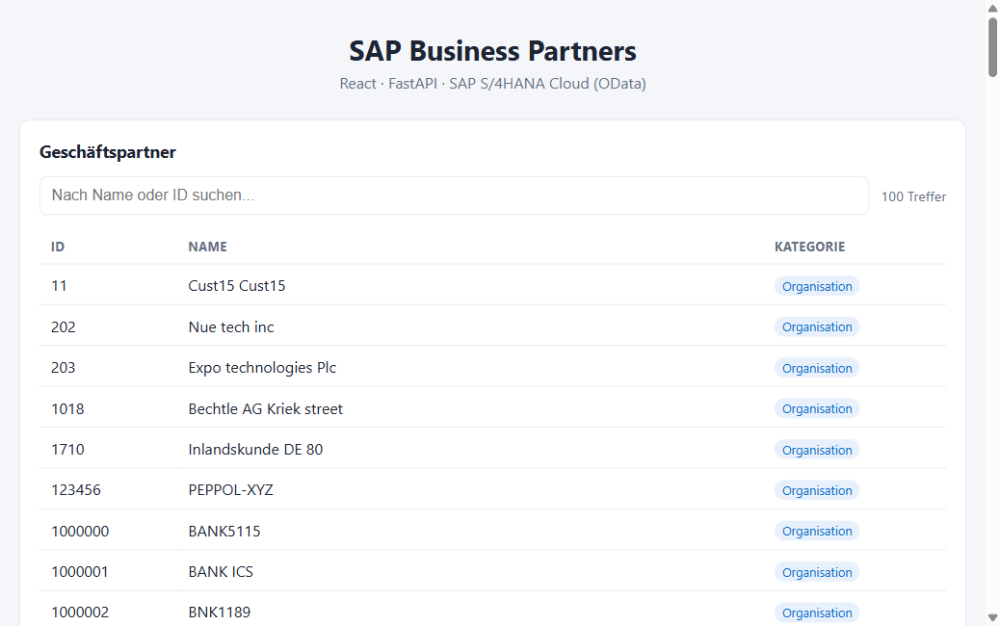
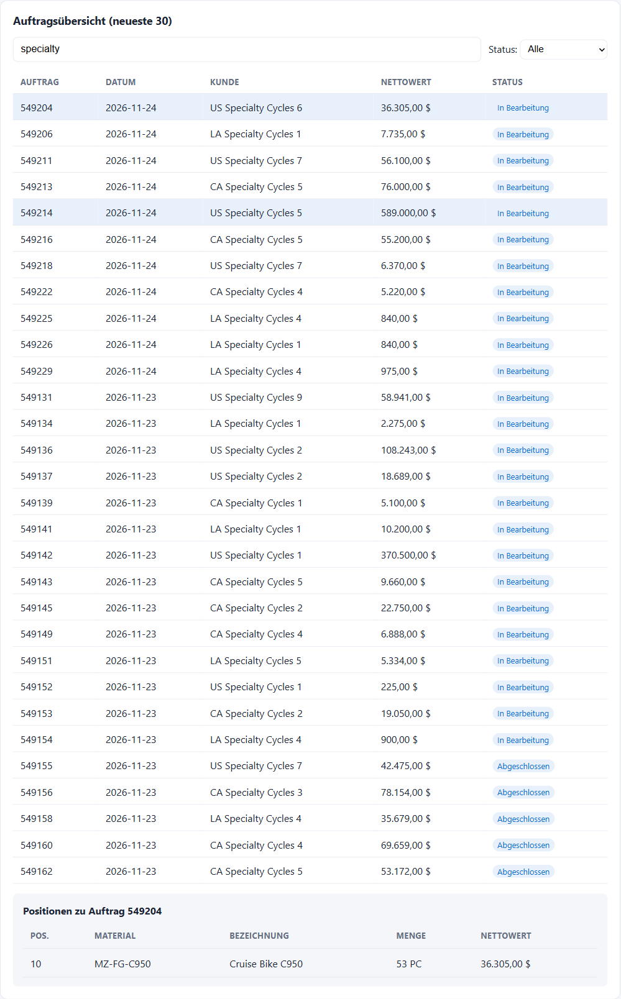

# SAP Business Partners Dashboard

Kleines Portfolio-Projekt: Eine React-Oberfläche zeigt Geschäftspartner und Aufträge aus der **SAP API Business Hub Sandbox** (S/4HANA Cloud, OData v2). Ein FastAPI-Backend kapselt den API-Key und bereitet die Daten auf.



## Funktionen

- **Geschäftspartner-Liste** (`API_BUSINESS_PARTNER`) mit Suche nach Name oder ID
- **Ladeanzeige** („Lädt...“) und Fehlermeldungen
- **Detailansicht** per Klick auf einen Partner: Adresse und E-Mail-Adresse(n)
- **Auftragsauswertung** (`API_SALES_ORDER_SRV`) mit Recharts:
  - Nettowert pro Monat (Liniendiagramm)
  - Top-8-Kunden nach Nettowert (Balkendiagramm)

### Auftragsübersicht (Beleg-Abfrage)



- Die neuesten 30 Kundenaufträge mit Datum, Kunde, Nettowert und Status
- **Filter nach Kundenname** (mit 0,4 s Verzögerung, damit nicht bei jedem Tastendruck SAP abgefragt wird) und **nach Status** (Offen / In Bearbeitung / Abgeschlossen)
- Beide Filter laufen **auf dem SAP-Server** (`$filter`), nicht im Browser
- Markierung „Liefersperre“ bei Aufträgen mit Lieferblock
- Klick auf einen Auftrag zeigt die **Positionen** (Kopf → Position, `to_Item`)

So funktioniert der Kundenname-Filter: Aufträge enthalten nur die Kundennummer (`SoldToParty`). Das Backend sucht zuerst die passenden Geschäftspartner über den Namen und filtert dann die Aufträge nach diesen Nummern. Die Namen der Treffer werden für die Anzeige wieder aufgelöst.

## Architektur

```
┌──────────────┐  fetch   ┌───────────────┐  OData v2 + APIKey  ┌────────────────────────┐
│ React (Vite) │ ───────▶ │ FastAPI       │ ──────────────────▶ │ SAP API Business Hub   │
│ :5173        │ ◀─────── │ :8000         │ ◀────────────────── │ Sandbox (S/4HANA Cloud)│
└──────────────┘   JSON   └───────────────┘        JSON         └────────────────────────┘
  Suche, Tabelle,          Key bleibt serverseitig,
  Details, Charts          Aggregation der Aufträge
```

| Endpunkt | Beschreibung |
|---|---|
| `GET /api/business-partners?top=20` | Liste der Geschäftspartner (max. 100) |
| `GET /api/business-partners/{id}` | Adresse und E-Mails eines Partners |
| `GET /api/sales-orders?top=30&status=A\|B\|C&customer=Name` | Auftragsliste (neueste zuerst), optional gefiltert nach Status und Kundenname |
| `GET /api/sales-orders/{id}/items` | Positionen eines Auftrags |
| `GET /api/sales-orders/summary` | Aufträge aggregiert nach Monat und Kunde |

## Technologien

- **Frontend:** React 19, TypeScript, Vite, Recharts
- **Backend:** Python, FastAPI, requests, python-dotenv
- **Datenquelle:** SAP API Business Hub Sandbox (`API_BUSINESS_PARTNER`, `API_SALES_ORDER_SRV`)

## Starten

Voraussetzungen: Python 3.11+, Node.js 20+ und ein kostenloser API-Key vom [SAP API Business Hub](https://api.sap.com/).

### 1. Backend

```bash
cd backend
pip install -r requirements.txt
echo SAP_API_KEY=dein_api_key > .env
uvicorn main:app --port 8000
```

### 2. Frontend

```bash
cd frontend
npm install
npm run dev
```

Anschließend [http://localhost:5173](http://localhost:5173) öffnen. (CORS im Backend ist auf diesen Port eingestellt.)

## Hinweise

- Die `.env`-Datei mit dem API-Key ist in `.gitignore` eingetragen und wird nicht eingecheckt.
- Die Sandbox enthält Testdaten: Viele Partner haben keine E-Mail-Adresse, die Aufträge sind nur in USD.
- Die Namenssuche unterscheidet in SAP zwischen Groß- und Kleinschreibung (`tolower()` wird nicht unterstützt). Das Backend probiert daher mehrere Schreibweisen (`specialty`, `Specialty`, `SPECIALTY`) und berücksichtigt höchstens 20 passende Kunden.
- Die Auftragsliste hat noch kein Paging (nur die neuesten 30).
- Die Auftragsauswertung zählt nur Aufträge in der Hauptwährung (keine Währungsumrechnung) und liest höchstens 1000 Aufträge.
